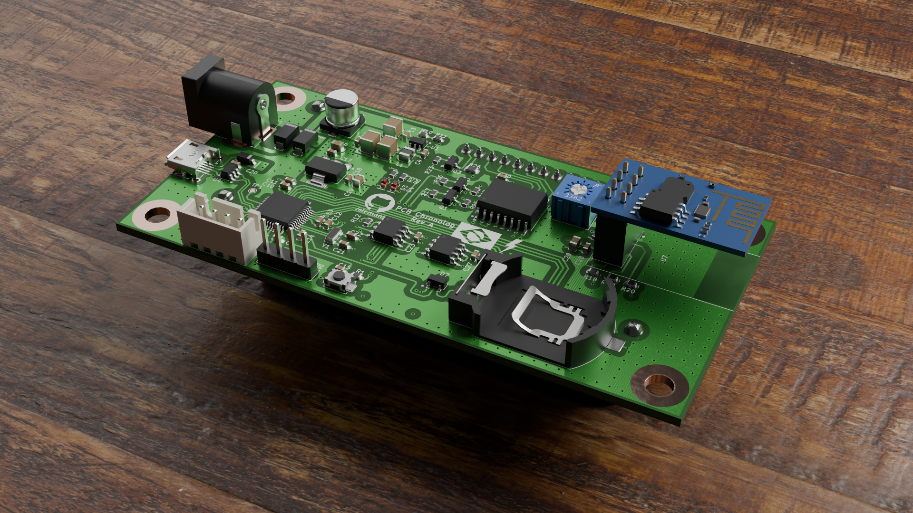
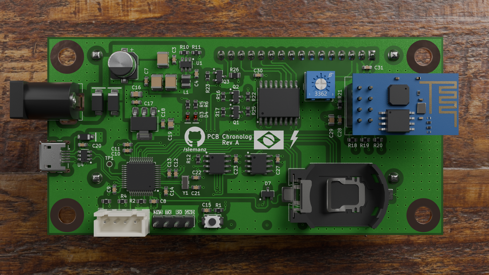
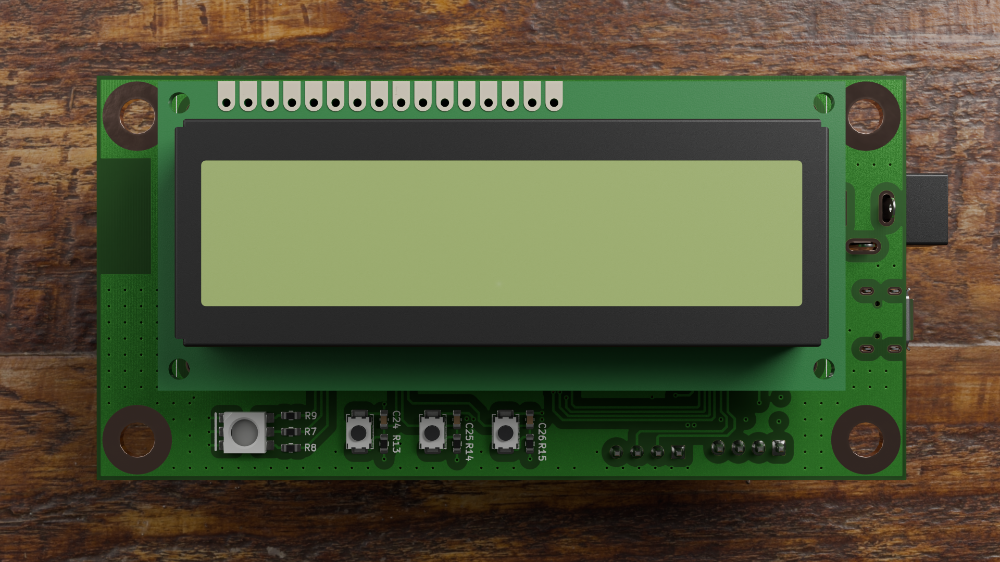
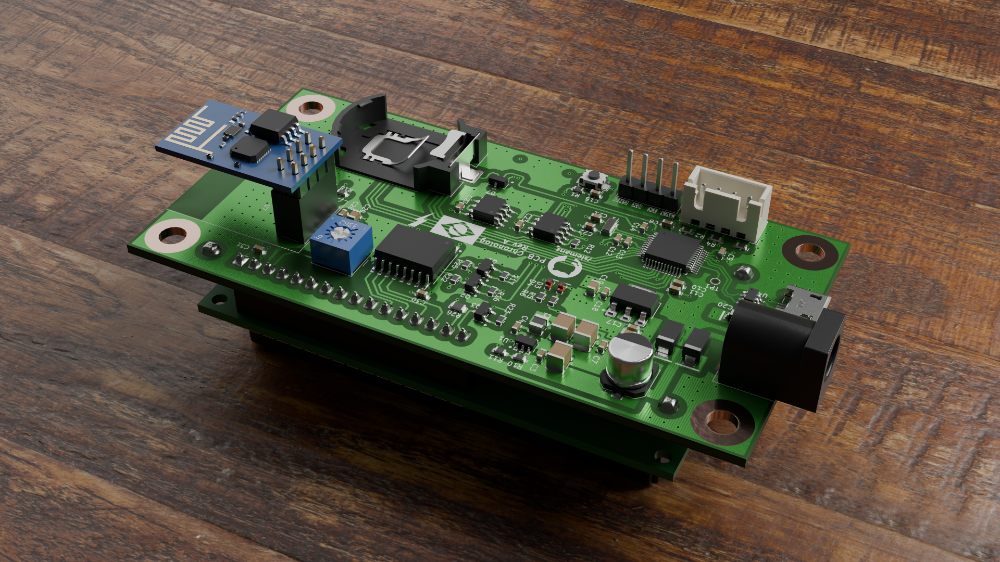
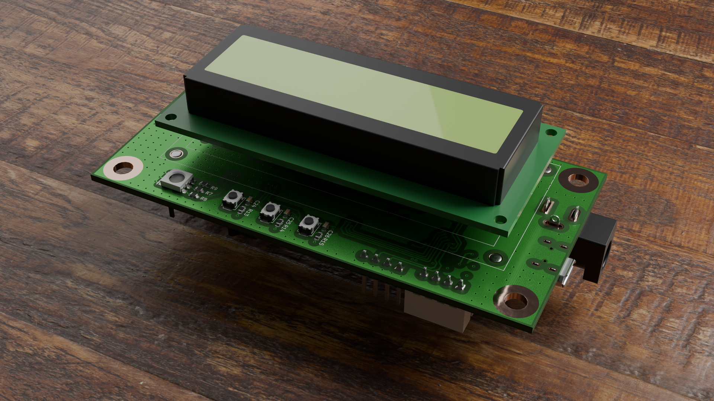
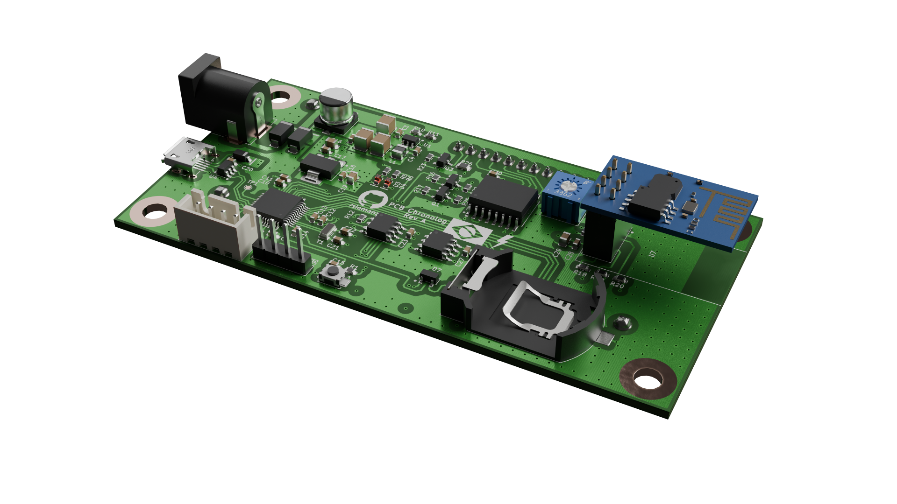
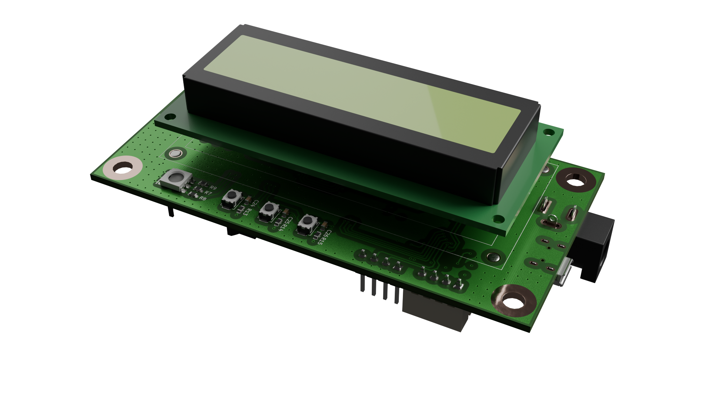
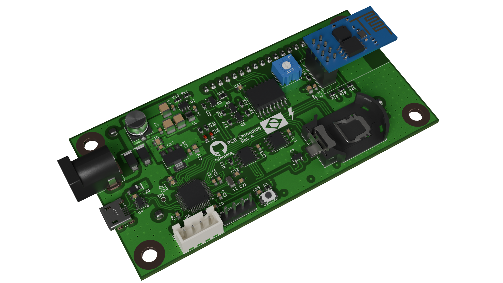

# Chronolog

  

  <b>Rev A</b> · Wi-Fi · RTC · 16x2 LCD

---

## Overview

| Top | Bottom |
|:---:|:---:|
|  |  |

## Highlights

- **ESP-01** Wi-Fi module
- **Coin cell RTC** backup (CR2032)
- **16x2 LCD** with 3 buttons and a status LED
- Power via **DC jack** or **micro USB**
- **UART** header (3V3 · TX · RX · GND) for debugging

## Gallery

| | |
|:---:|:---:|
|  |  |
|  |  |
|  |  |
|  | |

---

  <a href="../../">← Back to gallery</a>

